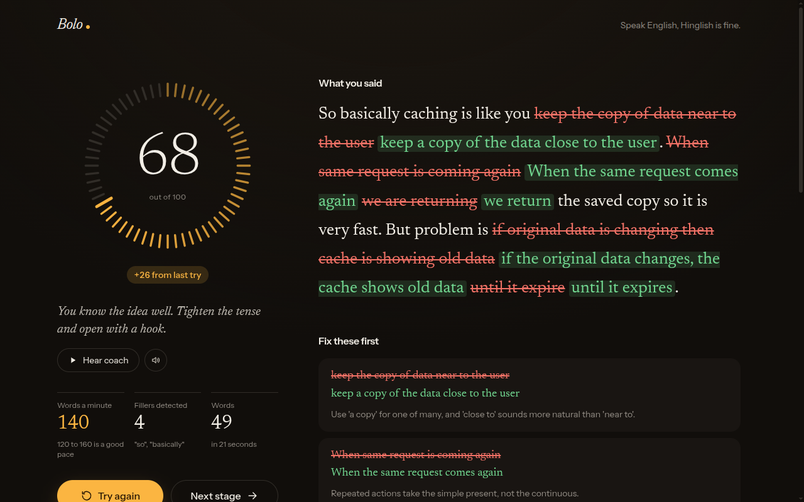

# Bolo

A speaking coach for engineers. Read a tech passage, say it from memory, build your own version, then speak freely. After every try you see the exact words you got wrong, grammar fixes on your own sentence, the structure of your answer, and a coach who talks back. Then you try again and watch the score go up.

**Live:** https://bolo-kohl.vercel.app

Built solo for the Great Indian AI Internship Challenge by Gnani AI.



## Four tracks, one ladder
| Track | What you practise |
|---|---|
| Tech Talk | Explaining REST, caching, Git, Docker, indexes and CI/CD |
| Grammar | Everyday sentence patterns, with the rule shown after each try |
| Creator | Talking to camera like a tech creator (the camera is an optional mirror; only your voice is scored) |
| Conversation | Voice role-plays: stand-up, HR round, explaining a bug, project walk-through |

Every task climbs the same four stages: **Read it**, **Say it back**, **Build your own**, **Free speak**. Each stage opens after one try of the one before. Progress stays in your browser.

## How it works
1. The browser records up to 30 seconds and converts it to 16 kHz mono WAV.
2. **Gnani Prisma v3.0** (speech to text) transcribes it, with keyterms for jargon and `en-IN,hi-IN` so Hinglish is fine.
3. Deterministic checks compare your words with the text (read accuracy) and measure pace and filler words detected.
4. **Gemini** (`gemini-3.8-flash`) returns grammar fixes, structure, a best-effort fact check and an improved version as JSON.
5. **Gnani Timbre v2.5** (text to speech) speaks the coaching back (voice Shlok) and reads the improved version (voice Girish).

Gnani models do all the speech work. Gemini is used only for text feedback.

## Run it
```bash
npm install
cp .env.example .env.local   # add GNANI_API_KEY and GEMINI_API_KEY
npm run dev                  # http://localhost:3000 (the mic works on localhost)
```
Preview the results screen without spending credits: `/lab/session?demo=free` or `?demo=read`.

Checks:
```bash
npx tsc --noEmit
npm run build
node --experimental-strip-types scripts/test-diff.ts
node --experimental-strip-types scripts/test-practice.ts
```

## Stack
Next.js 16 (App Router, TypeScript, Tailwind 4) on Vercel. Route handlers in `src/app/api/*` call Gnani and Gemini, so keys never reach the browser. No database and no accounts.

## Working on it with Claude Code
Start with `CLAUDE.md`, then `docs/BUILD_PLAN.md` and `docs/DECISIONS.md`.

Fonts: Newsreader and Instrument Sans (SIL Open Font License, see `assets/fonts/OFL.txt`).
